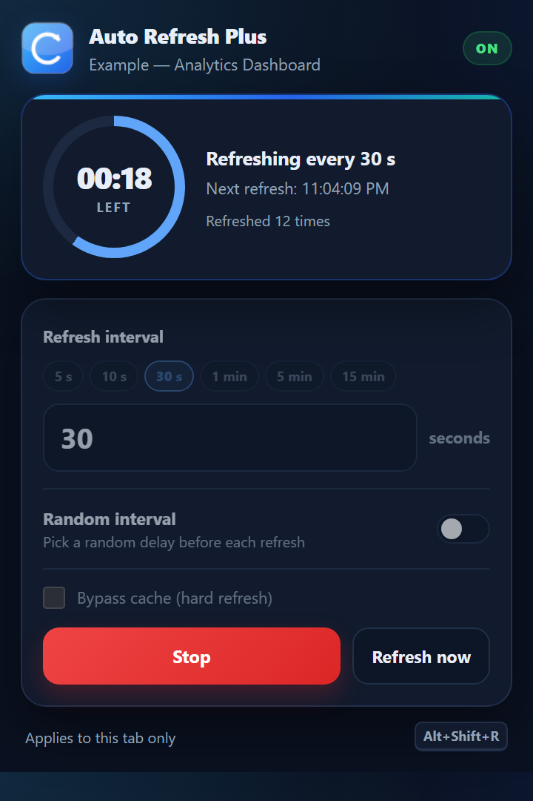

<p align="center">
  
</p>

<h1 align="center">Auto Refresh Plus for Firefox</h1>

<p align="center">
  Automatically refresh any tab at your chosen interval — with a live countdown badge, quick presets, random timing, and optional cache bypass.
</p>

<p align="center">
  <a href="https://github.com/cengizkemec/auto-refresh-plus-firefox/releases/latest"></a>
  
  
  
  
</p>

<p align="center">
  <strong>English</strong> · <a href="README.tr.md">Türkçe</a>
</p>

<p align="center">
  
  <br>
  <sub>English UI · <a href="docs/screenshots/popup-tr.png">Türkçe arayüz</a></sub>
</p>

## Download

| Package | File |
| --- | --- |
| Firefox add-on (ZIP) | [`auto-refresh-plus-firefox-1.0.0.zip`](https://github.com/cengizkemec/auto-refresh-plus-firefox/releases/latest/download/auto-refresh-plus-firefox-1.0.0.zip) |
| Firefox add-on (XPI, unsigned) | [`auto-refresh-plus-firefox-1.0.0.xpi`](https://github.com/cengizkemec/auto-refresh-plus-firefox/releases/latest/download/auto-refresh-plus-firefox-1.0.0.xpi) |
| SHA-256 checksums | [`SHA256SUMS.txt`](https://github.com/cengizkemec/auto-refresh-plus-firefox/releases/latest/download/SHA256SUMS.txt) |

> The builds are **unsigned**. See [Installation](#installation) for temporary loading and signing options.

## Features

- **Per-tab refresh schedules** — every tab has its own interval; switching tabs or closing the popup does not stop the timer.
- **Flexible intervals** — from 1 second to 86,400 seconds (24 hours).
- **Quick presets** — 5 s, 10 s, 30 s, 1 min, 5 min, and 15 min.
- **Random interval mode** — choose a minimum and maximum delay; a new random delay is picked for every refresh.
- **Live countdown badge** — the toolbar icon shows the remaining time for each tab, with a progress ring and reload counter in the popup.
- **Hard refresh** — optionally bypass the browser cache with `tabs.reload({ bypassCache: true })`.
- **Multiple controls** — start/stop from the popup, the `Alt+Shift+R` shortcut, or the toolbar icon's right-click menu.
- **Quick-start context menu** — start a fixed interval directly from the toolbar icon menu.
- **Safe cleanup** — timers stop when the tab closes; reload errors stop the schedule and show an error badge instead of looping.
- **English + Turkish UI** — follows the Firefox interface language; English is the fallback.
- **Dark and light themes** — follows the operating system / Firefox theme.
- **No tracking** — no analytics, no telemetry, no network requests, no content scripts, and no host permissions.

## Installation

### Option A — temporary install (recommended for testing)

1. Download the ZIP and extract it.
2. Open `about:debugging#/runtime/this-firefox` in Firefox.
3. Click **Load Temporary Add-on…**.
4. Select `manifest.json` from the extracted folder.
5. Pin **Auto Refresh Plus** to the toolbar if it is not visible.

The add-on stays installed until you restart Firefox.

### Option B — permanent install

Firefox Release requires Mozilla-signed add-ons.

- Upload the ZIP to [addons.mozilla.org/developers](https://addons.mozilla.org/developers/) to have it signed, then install the signed XPI.
- On **Firefox Developer Edition** or **Firefox Nightly**, you can set `xpinstall.signatures.required` to `false` in `about:config` and install the unsigned XPI via `about:addons` → gear menu → **Install Add-on From File…**. This is intended for development only.

The `.xpi` in the release is the same build as the `.zip`, packaged for signing/testing. It does not work as a permanent install on standard Firefox without a signature.

## Usage

1. Open the page you want to refresh.
2. Click the **Auto Refresh Plus** toolbar icon.
3. Enter an interval in seconds, or pick a preset.
4. Optionally enable **Random interval** and set the minimum/maximum delay, or enable **Bypass cache**.
5. Press **Start**.

The badge on the toolbar icon counts down to the next refresh. Press **Stop** in the popup, use `Alt+Shift+R`, or right-click the toolbar icon and choose **Start / stop auto refresh**.

### Toolbar right-click menu

Right-click the extension icon to:

- start or stop auto refresh;
- refresh the active tab immediately;
- start a fixed interval (5 s, 10 s, 30 s, 1 min, 5 min, 15 min).

### Keyboard shortcut

| Shortcut | Action |
| --- | --- |
| `Alt+Shift+R` | Start / stop auto refresh for the active tab |

Firefox lets you change this shortcut under `about:addons` → gear → **Manage Extension Shortcuts**.

### Behavior notes

- Settings are **per tab**. Different tabs can refresh at different intervals.
- Closing the tab stops its timer.
- Restarting Firefox clears all schedules; the last used settings are remembered for the next start.
- If a page takes longer than the interval to load, the next countdown starts after the reload is requested, not after the page finishes loading.
- Pages that cannot be reloaded by extensions (`about:`, `moz-extension:`, `view-source:`, `data:`, and similar) are rejected with an error.
- A POST result page may show Firefox's "resubmit form" confirmation when refreshed.

## How it works

This is a plain WebExtension with no build step and no third-party dependencies.

- `background.js` keeps a `Map<tabId, session>` and a 250 ms ticker.
- A session stores the interval/random range, next refresh timestamp, current cycle duration, and reload count.
- When the countdown reaches zero, the extension calls `browser.tabs.reload(tabId, { bypassCache })`, updates the per-tab badge, and schedules the next cycle.
- The popup only reads/sends messages; it does not own the timer, so closing it does not affect refresh behavior.
- Manifest V2 is used intentionally: Firefox MV2 supports a persistent background page, which makes sub-minute timers reliable. Firefox still supports MV2 add-ons.
- The UI and all messages are localized with `browser.i18n` using `_locales/en` and `_locales/tr`.

### Project structure

```text
auto-refresh-plus-firefox/
├── manifest.json
├── background.js
├── popup.html
├── popup.css
├── popup.js
├── icons/
│   ├── icon-16.png
│   ├── icon-32.png
│   ├── icon-48.png
│   ├── icon-96.png
│   └── icon-128.png
├── _locales/
│   ├── en/messages.json
│   └── tr/messages.json
├── docs/screenshots/
├── README.md
├── README.tr.md
├── PRIVACY.md
├── CHANGELOG.md
├── LICENSE
└── .gitignore
```

## Permissions

| Permission | Why it is needed |
| --- | --- |
| `storage` | Remember the last used interval, random range, and cache-bypass preference. |
| `tabs` | Read the active tab's title for the popup and call `tabs.reload()`. |
| `menus` | Add the right-click menu to the toolbar icon. |

The extension does **not** request `<all_urls>` or inject content scripts. It cannot read or modify page content, and it makes no network requests.

## Privacy

No data is collected, transmitted, sold, or shared. The only stored data is the last refresh configuration in Firefox's local extension storage. Active timers live in memory and are discarded when the tab closes or Firefox restarts.

Read the full [privacy policy](PRIVACY.md). The manifest declares `data_collection_permissions.required = ["none"]`.

## Compatibility and limitations

- **Firefox desktop 109+** (Windows, macOS, Linux). Firefox for Android is not targeted.
- Privileged pages such as `about:addons`, `about:debugging`, `moz-extension://`, `view-source:`, and `data:` cannot be refreshed automatically.
- Some sites ask for confirmation before leaving or resubmitting a form; Firefox controls that prompt, not the extension.
- If the system sleeps, the timer resumes when Firefox wakes up. A refresh may happen immediately if the scheduled time has passed.
- The badge shows seconds up to 99, then minutes/hours (for example `5m`), to stay readable in the toolbar.

## Localization

The UI follows the Firefox interface language:

- `en` — English (default/fallback)
- `tr` — Turkish

To test another locale with `web-ext`:

```bash
web-ext run --pref intl.locale.requested=tr
```

To add a language, copy `_locales/en/messages.json` to `_locales/<code>/messages.json`, translate the values, and keep the keys unchanged. The HTML/JS strings are resolved through `data-i18n` attributes and `browser.i18n.getMessage()`.

## Development

### Requirements

- Firefox 109 or newer
- [web-ext](https://extensionworkshop.com/documentation/develop/getting-started-with-web-ext/) (optional, for linting/running)

### Lint and run

```bash
npx web-ext lint --source-dir .
npx web-ext run --source-dir .
```

The repository is checked with `web-ext lint` (0 errors) and automated smoke tests for the popup, background messaging, and English/Turkish localization.

### Build a release package

Include only runtime files (not `docs/`, README files, or development files):

```bash
zip -r auto-refresh-plus-firefox-1.0.0.zip \
  manifest.json background.js popup.html popup.css popup.js \
  icons _locales LICENSE
```

Windows PowerShell:

```powershell
Compress-Archive -Path manifest.json,background.js,popup.html,popup.css,popup.js,icons,_locales,LICENSE `
  -DestinationPath auto-refresh-plus-firefox-1.0.0.zip
```

## Release assets

- `auto-refresh-plus-firefox-1.0.0.zip` — installable source package for temporary loading and AMO signing.
- `auto-refresh-plus-firefox-1.0.0.xpi` — same build, unsigned, for signing/testing.
- `SHA256SUMS.txt` — SHA-256 checksums for both files.

See [Releases](https://github.com/cengizkemec/auto-refresh-plus-firefox/releases) for all versions.

## Disclaimer

This is an independent Firefox implementation inspired by the Chrome Web Store extension **Auto Refresh Plus**. It is not affiliated with, endorsed by, or sponsored by the original publisher. All code and icons in this repository are original work. Product names and trademarks belong to their respective owners.

## License

[MIT](LICENSE) © 2026 Cengiz Kemeç
