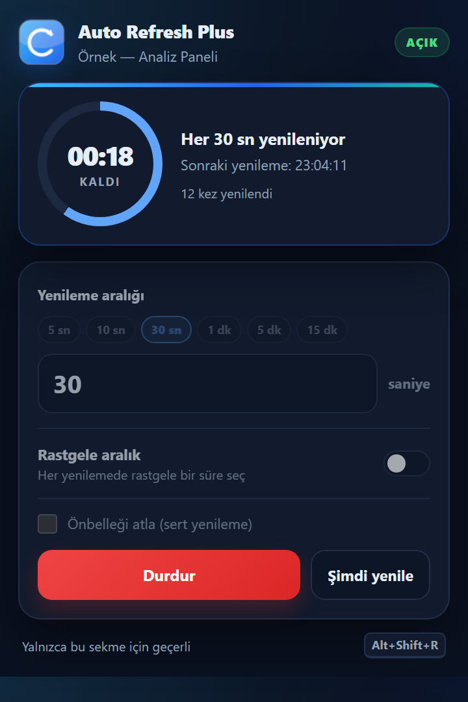

<p align="center">
  
</p>

<h1 align="center">Firefox için Auto Refresh Plus</h1>

<p align="center">
  Herhangi bir sekmeyi seçtiğiniz aralıkla otomatik yeniler — canlı geri sayım rozeti, hazır aralıklar, rastgele süre ve isteğe bağlı önbellek atlama ile.
</p>

<p align="center">
  <a href="https://github.com/cengizkemec/auto-refresh-plus-firefox/releases/latest"></a>
  
  
  
  
</p>

<p align="center">
  <a href="README.md">English</a> · <strong>Türkçe</strong>
</p>

<p align="center">
  
  <br>
  <sub>Türkçe arayüz · <a href="docs/screenshots/popup-en.png">English UI</a></sub>
</p>

## İndirme

| Paket | Dosya |
| --- | --- |
| Firefox eklentisi (ZIP) | [`auto-refresh-plus-firefox-1.0.0.zip`](https://github.com/cengizkemec/auto-refresh-plus-firefox/releases/latest/download/auto-refresh-plus-firefox-1.0.0.zip) |
| Firefox eklentisi (XPI, imzasız) | [`auto-refresh-plus-firefox-1.0.0.xpi`](https://github.com/cengizkemec/auto-refresh-plus-firefox/releases/latest/download/auto-refresh-plus-firefox-1.0.0.xpi) |
| SHA-256 özetleri | [`SHA256SUMS.txt`](https://github.com/cengizkemec/auto-refresh-plus-firefox/releases/latest/download/SHA256SUMS.txt) |

> Paketler **imzasızdır**. Geçici yükleme ve imzalama seçenekleri için [Kurulum](#kurulum) bölümüne bakın.

## Özellikler

- **Sekme başına yenileme planı** — her sekmenin kendi aralığı vardır; sekme değiştirmek veya popup'ı kapatmak zamanlayıcıyı durdurmaz.
- **Esnek aralıklar** — 1 saniyeden 86.400 saniyeye (24 saat) kadar.
- **Hazır aralıklar** — 5 sn, 10 sn, 30 sn, 1 dk, 5 dk ve 15 dk.
- **Rastgele aralık** — en az ve en çok süreyi seçin; her yenilemede yeni bir rastgele süre hesaplanır.
- **Canlı geri sayım rozeti** — araç çubuğu simgesi her sekme için kalan süreyi gösterir; popup'ta ilerleme halkası ve yenileme sayacı bulunur.
- **Sert yenileme** — isteğe bağlı olarak `tabs.reload({ bypassCache: true })` ile tarayıcı önbelleği atlanır.
- **Birden fazla kontrol** — popup, `Alt+Shift+R` kısayolu veya araç çubuğu simgesinin sağ tık menüsü.
- **Hızlı başlatma menüsü** — araç çubuğu menüsünden doğrudan sabit aralıkla başlatma.
- **Güvenli temizlik** — sekme kapanınca zamanlayıcı durur; yenileme hatasında döngüye girmek yerine plan durur ve hata rozeti gösterilir.
- **Türkçe + İngilizce arayüz** — Firefox arayüz dilini takip eder; varsayılan yedek dil İngilizcedir.
- **Koyu ve açık tema** — işletim sistemi / Firefox temasına uyum sağlar.
- **Takip yok** — analitik, telemetri, ağ isteği, content script veya ana makine izni yoktur.

## Kurulum

### Seçenek A — geçici kurulum (test için önerilir)

1. ZIP dosyasını indirip çıkarın.
2. Firefox'ta `about:debugging#/runtime/this-firefox` adresini açın.
3. **Load Temporary Add-on…** düğmesine tıklayın.
4. Çıkarılan klasördeki `manifest.json` dosyasını seçin.
5. **Auto Refresh Plus** görünmüyorsa araç çubuğuna sabitleyin.

Eklenti, Firefox yeniden başlatılana kadar yüklü kalır.

### Seçenek B — kalıcı kurulum

Firefox Release sürümü Mozilla tarafından imzalanmış eklentileri kabul eder.

- ZIP dosyasını [addons.mozilla.org/developers](https://addons.mozilla.org/developers/) adresine yükleyip imzalatın ve imzalı XPI dosyasını kurun.
- **Firefox Developer Edition** veya **Firefox Nightly** kullanıyorsanız `about:config` üzerinden `xpinstall.signatures.required` ayarını `false` yapıp `about:addons` → dişli menüsü → **Install Add-on From File…** ile imzasız XPI dosyasını kurabilirsiniz. Bu yöntem yalnızca geliştirme içindir.

Sürümdeki `.xpi`, `.zip` ile aynı yapıdır; imzalama/test için paketlenmiştir. Standart Firefox'ta imza olmadan kalıcı kurulum yapılamaz.

## Kullanım

1. Yeniletmek istediğiniz sayfayı açın.
2. **Auto Refresh Plus** araç çubuğu simgesine tıklayın.
3. Saniye cinsinden bir aralık girin veya hazır aralıklardan birini seçin.
4. İsteğe bağlı olarak **Rastgele aralık** seçeneğini açıp en az/en çok süreyi ayarlayın ya da **Önbelleği atla** seçeneğini işaretleyin.
5. **Başlat** düğmesine basın.

Araç çubuğu rozeti bir sonraki yenilemeye kalan süreyi gösterir. Popup'tan **Durdur**, `Alt+Shift+R` kısayolu veya araç çubuğu simgesine sağ tıklayıp **Otomatik yenilemeyi başlat / durdur** ile durdurabilirsiniz.

### Araç çubuğu sağ tık menüsü

Eklenti simgesine sağ tıklayarak:

- otomatik yenilemeyi başlatabilir/durdurabilir;
- etkin sekmeyi hemen yenileyebilir;
- sabit aralıkla başlatabilirsiniz (5 sn, 10 sn, 30 sn, 1 dk, 5 dk, 15 dk).

### Klavye kısayolu

| Kısayol | İşlev |
| --- | --- |
| `Alt+Shift+R` | Etkin sekmede otomatik yenilemeyi başlat / durdur |

Kısayolu `about:addons` → dişli → **Manage Extension Shortcuts** bölümünden değiştirebilirsiniz.

### Davranış notları

- Ayarlar **sekme bazlıdır**. Farklı sekmeler farklı aralıklarla yenilenebilir.
- Sekme kapanınca zamanlayıcı durur.
- Firefox yeniden başlayınca tüm planlar temizlenir; son kullanılan ayarlar bir sonraki başlatma için saklanır.
- Sayfa yüklenmesi aralıktan uzun sürerse bir sonraki geri sayım, yenileme isteğinden sonra başlar; sayfanın tamamen yüklenmesi beklenmez.
- Eklentilerin yenileyemediği sayfalar (`about:`, `moz-extension:`, `view-source:`, `data:` ve benzerleri) hata ile reddedilir.
- POST sonucu sayfalarında yenileme, Firefox'un "formu yeniden gönder" onayını gösterebilir.

## Nasıl çalışır?

Bu, derleme adımı ve üçüncü taraf bağımlılığı olmayan düz bir WebExtension'dır.

- `background.js`, `Map<tabId, oturum>` ve 250 ms'lik bir zamanlayıcı tutar.
- Oturum; aralık/rastgele aralık, sonraki yenileme zamanı, mevcut döngü süresi ve yenileme sayısını saklar.
- Geri sayım sıfıra ulaşınca `browser.tabs.reload(tabId, { bypassCache })` çağrılır, sekme rozeti güncellenir ve sonraki döngü planlanır.
- Popup yalnızca mesaj okur/gönderir; zamanlayıcıyı yönetmez. Bu yüzden popup kapanınca yenileme etkilenmez.
- Manifest V2 bilinçli olarak kullanılmıştır: Firefox MV2 kalıcı arka plan sayfasını destekler ve dakika altı zamanlayıcılar güvenilir çalışır. Firefox MV2 eklentilerini desteklemeye devam etmektedir.
- Tüm arayüz ve mesajlar `browser.i18n` ile `_locales/en` ve `_locales/tr` üzerinden yerelleştirilir.

### Proje yapısı

```text
auto-refresh-plus-firefox/
├── manifest.json
├── background.js
├── popup.html
├── popup.css
├── popup.js
├── icons/
│   ├── icon-16.png
│   ├── icon-32.png
│   ├── icon-48.png
│   ├── icon-96.png
│   └── icon-128.png
├── _locales/
│   ├── en/messages.json
│   └── tr/messages.json
├── docs/screenshots/
├── README.md
├── README.tr.md
├── PRIVACY.md
├── CHANGELOG.md
├── LICENSE
└── .gitignore
```

## İzinler

| İzin | Neden gerekli? |
| --- | --- |
| `storage` | Son kullanılan aralığı, rastgele aralığı ve önbellek atlama tercihini hatırlamak. |
| `tabs` | Popup için etkin sekmenin başlığını okumak ve `tabs.reload()` çağırmak. |
| `menus` | Araç çubuğu simgesine sağ tık menüsü eklemek. |

Eklenti `<all_urls>` izni istemez ve content script enjekte etmez. Sayfa içeriğini okuyamaz/değiştiremez ve hiçbir ağ isteği göndermez.

## Gizlilik

Hiçbir veri toplanmaz, iletilmez, satılmaz veya paylaşılmaz. Saklanan tek veri, Firefox yerel eklenti depolamasındaki son yenileme ayarıdır. Etkin zamanlayıcılar bellekte tutulur; sekme kapanınca veya Firefox yeniden başlayınca silinir.

Tam [gizlilik politikasını](PRIVACY.md) okuyun. Manifest `data_collection_permissions.required = ["none"]` bildirir.

## Uyumluluk ve sınırlamalar

- **Firefox masaüstü 109+** (Windows, macOS, Linux). Firefox for Android hedeflenmez.
- `about:addons`, `about:debugging`, `moz-extension://`, `view-source:` ve `data:` gibi ayrıcalıklı sayfalar otomatik yenilenemez.
- Bazı siteler sayfadan ayrılırken veya formu yeniden gönderirken onay ister; bu istemi Firefox yönetir, eklenti değil.
- Sistem uyku moduna girerse zamanlayıcı Firefox uyanınca devam eder. Planlanan zaman geçmişse yenileme hemen gerçekleşebilir.
- Rozet, araç çubuğunda okunabilir kalmak için 99 saniyeye kadar saniye, sonrasında dakika/saat (ör. `5m`) gösterir.

## Yerelleştirme

Arayüz, Firefox arayüz dilini takip eder:

- `en` — İngilizce (varsayılan/yedek)
- `tr` — Türkçe

`web-ext` ile başka bir dili test etmek için:

```bash
web-ext run --pref intl.locale.requested=tr
```

Yeni bir dil eklemek için `_locales/en/messages.json` dosyasını `_locales/<kod>/messages.json` olarak kopyalayın, değerleri çevirin ve anahtarları değiştirmeyin. HTML/JS metinleri `data-i18n` nitelikleri ve `browser.i18n.getMessage()` üzerinden çözülür.

## Geliştirme

### Gereksinimler

- Firefox 109 veya üzeri
- [web-ext](https://extensionworkshop.com/documentation/develop/getting-started-with-web-ext/) (isteğe bağlı; lint ve çalıştırma için)

### Lint ve çalıştırma

```bash
npx web-ext lint --source-dir .
npx web-ext run --source-dir .
```

Depo `web-ext lint` ile (0 hata) ve popup, arka plan mesajlaşması ve yerelleştirme için otomatik smoke testleriyle kontrol edilmiştir.

### Sürüm paketi oluşturma

Yalnızca çalışma zamanı dosyalarını ekleyin (`docs/`, README dosyaları ve geliştirme dosyaları hariç):

```bash
zip -r auto-refresh-plus-firefox-1.0.0.zip \
  manifest.json background.js popup.html popup.css popup.js \
  icons _locales LICENSE
```

Windows PowerShell:

```powershell
Compress-Archive -Path manifest.json,background.js,popup.html,popup.css,popup.js,icons,_locales,LICENSE `
  -DestinationPath auto-refresh-plus-firefox-1.0.0.zip
```

## Sürüm dosyaları

- `auto-refresh-plus-firefox-1.0.0.zip` — geçici yükleme ve AMO imzalama için kaynak paketi.
- `auto-refresh-plus-firefox-1.0.0.xpi` — aynı yapı, imzasız; imzalama/test için.
- `SHA256SUMS.txt` — iki dosyanın SHA-256 özetleri.

Tüm sürümler: [Releases](https://github.com/cengizkemec/auto-refresh-plus-firefox/releases).

## Sorumluluk reddi

Bu proje, Chrome Web Store'daki **Auto Refresh Plus** eklentisinden ilham alan bağımsız bir Firefox uygulamasıdır. Orijinal yayıncı ile bağlantılı değildir, onun tarafından desteklenmez veya sponsor edilmez. Bu depodaki tüm kod ve simgeler özgün çalışmadır. Ürün adları ve ticari markalar ilgili sahiplerine aittir.

## Lisans

[MIT](LICENSE) © 2026 Cengiz Kemeç
